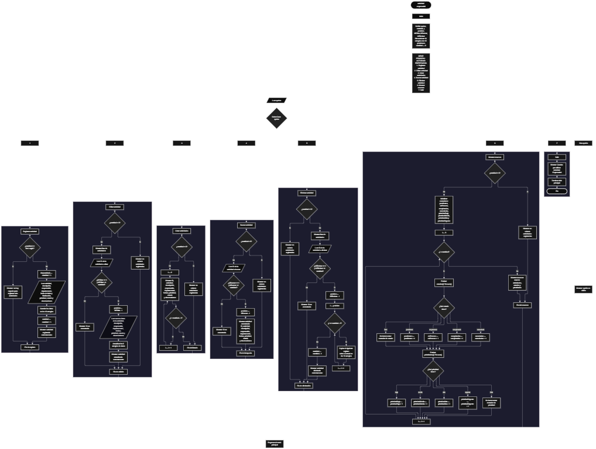

Este proyecto, llamado <b>actividad empresarial</b>, fue desarrollado en <b>visual basic .net</b> como un ejercicio práctico para fortalecer la lógica de programación mediante la creación de un sistema de gestión de actividades empresariales desde la consola. El programa cuenta con un menú principal de siete opciones que permite <b>registrar, editar, eliminar, buscar, listar y consultar un resumen</b> de las actividades registradas. Cada actividad almacena información como el nombre, la descripción, el responsable, el departamento, las fechas de inicio y finalización, la prioridad, el estado y las observaciones, utilizando arreglos con una capacidad máxima de <b>10 actividades durante la ejecución</b>. Durante su desarrollo se aplicaron conceptos fundamentales de programación, como variables, arreglos, estructuras condicionales, ciclos repetitivos y estructuras de selección, además de procesos para modificar, buscar, eliminar y reorganizar registros. También se implementó un sistema de clasificación que permite contabilizar las actividades según su estado y nivel de prioridad. Este proyecto permite poner en práctica los conocimientos adquiridos en Visual Basic .NET y sirve como base para desarrollar sistemas de gestión empresarial más completos.

<h2 align="center">⚙️ Funcionamiento del menú principal</h2>

### ➕ Registrar actividad

La opción <b>1) registrar actividad</b> permite almacenar una nueva actividad empresarial. Antes de realizar el registro, el sistema comprueba que la cantidad de actividades almacenadas sea menor que la capacidad máxima de los arreglos, utilizando la condición <b>cantidad >= ids.Length</b>. Si se alcanza el límite de <b>10 actividades</b>, muestra el mensaje <b>"No hay espacio para registrar mas actividades."</b> e impide agregar otro registro. Si existe espacio disponible, asigna un identificador mediante <b>ids(cantidad) = cantidad + 1</b> y solicita los datos correspondientes: <b>actividad, descripción, responsable, departamento, fecha de inicio, fecha de finalización, prioridad, estado y observaciones</b>. Cada dato se almacena en la posición correspondiente de su respectivo arreglo. Finalmente, aumenta la variable <b>cantidad</b> en uno y muestra el mensaje <b>"Actividad registrada correctamente."</b>.

### ✏️ Editar actividad

La opción <b>2) editar actividad</b> permite modificar la información de una actividad registrada. Primero, el programa comprueba si existen actividades almacenadas mediante la variable <b>cantidad</b>. Si no hay registros, muestra el mensaje <b>"No existen actividades registradas."</b>. En caso contrario, presenta una lista con el ID, la actividad, la descripción, el responsable, el departamento, las fechas, la prioridad, el estado y las observaciones de cada registro. Después, solicita el ID de la actividad que se desea editar y comprueba que esté dentro del rango permitido mediante la condición <b>idEditar >= 1 And idEditar <= cantidad</b>. Si la selección es válida, calcula la posición correspondiente utilizando <b>posicion = idEditar - 1</b> y solicita los nuevos datos de la actividad. La información se actualiza directamente en los arreglos correspondientes. Finalmente, muestra el mensaje <b>"Actividad actualizada correctamente."</b>. Si el ID seleccionado no está dentro del rango permitido, presenta el mensaje <b>"ID no encontrada."</b>.

### 📋 Listar actividades

La opción <b>3) listar actividades</b> permite visualizar todas las actividades registradas actualmente. Antes de mostrar la información, el programa comprueba si la variable <b>cantidad</b> es igual a cero. Si no existen registros, presenta el mensaje <b>"No existen actividades registradas."</b>. Si hay actividades disponibles, muestra el encabezado <b>"lista de actividades"</b> y utiliza un ciclo <b>For ... Next</b> para recorrer los arreglos desde la posición <b>0</b> hasta <b>cantidad - 1</b>. Durante el recorrido, presenta el ID, la actividad, la descripción, el responsable, el departamento, la fecha de inicio, la fecha de finalización, la prioridad, el estado y las observaciones de cada registro. Esta función facilita consultar la información almacenada sin necesidad de buscar cada actividad individualmente.

### 🔎 Buscar actividad

La opción <b>4) buscar actividad</b> permite localizar una actividad mediante su identificador. Primero, el programa comprueba si existen actividades registradas. Si la cantidad es igual a <b>0</b>, muestra el mensaje <b>"No existen actividades registradas."</b>. En caso contrario, solicita el ID de la actividad que se desea buscar y comprueba que esté dentro del rango permitido mediante la condición <b>idBuscar >= 1 And idBuscar <= cantidad</b>. Si el identificador es válido, calcula su posición utilizando <b>posicion = idBuscar - 1</b> y muestra la información completa de la actividad encontrada: <b>ID, actividad, descripción, responsable, departamento, fechas, prioridad, estado y observaciones</b>. Si el ID introducido no corresponde a una posición dentro del rango permitido, presenta el mensaje <b>"ID no encontrada."</b>. La búsqueda se realiza mediante el identificador y el acceso directo a la posición correspondiente del arreglo.

### 🗑️ Eliminar actividad

La opción <b>5) eliminar actividad</b> permite eliminar una actividad registrada mediante su identificador. Primero, el programa comprueba si existen actividades almacenadas. Si no hay registros, muestra el mensaje <b>"No existen actividades registradas."</b>. Si existen actividades, presenta una lista con todos sus datos y solicita el ID de la actividad que se desea eliminar. Después, verifica que el identificador esté dentro del rango permitido mediante la condición <b>idEliminar >= 1 And idEliminar <= cantidad</b>. Si la selección es válida, calcula la posición correspondiente utilizando <b>posicion = idEliminar - 1</b> y comienza el proceso de eliminación. Para mantener organizados los registros, utiliza un ciclo <b>For ... Next</b> que desplaza una posición hacia atrás los datos posteriores en los diez arreglos: <b>ids, actividades, descripciones, responsables, departamentos, fechasInicio, fechasFinalizacion, prioridades, estados y observaciones</b>. Posteriormente, disminuye la variable <b>cantidad</b> en uno y muestra el mensaje <b>"Actividad eliminada correctamente."</b>. Si el ID seleccionado no está dentro del rango permitido, presenta el mensaje <b>"ID no encontrada."</b>.

### 📊 Mostrar resumen

La opción <b>6) mostrar resumen</b> permite consultar una clasificación general de las actividades registradas según su estado y nivel de prioridad. Primero, el programa comprueba si existen actividades almacenadas. Si la variable <b>cantidad</b> es igual a cero, muestra el mensaje <b>"No existen actividades registradas."</b>. En caso contrario, inicializa ocho variables contadoras en cero: <b>pendientes, enProceso, completadas, canceladas, prioridadBaja, prioridadMedia, prioridadAlta y prioridadUrgente</b>. Después, utiliza un ciclo <b>For ... Next</b> para recorrer las actividades registradas y clasificar cada una mediante las estructuras <b>If</b> y <b>ElseIf</b>. Para comparar los valores de los estados y las prioridades, utiliza el método <b>ToLower()</b>, que convierte el texto a minúsculas antes de realizar la comparación. Finalmente, presenta el total de actividades registradas, la cantidad de actividades pendientes, en proceso, completadas y canceladas, además de la cantidad correspondiente a cada nivel de prioridad: baja, media, alta y urgente. Esta función permite obtener una visión general de la distribución de las actividades empresariales.

### 🚪 Salir del menú principal

La opción <b>7) salir</b> está destinada a finalizar la ejecución del programa y muestra el mensaje <b>"Gracias por utilizar Actividad Empresarial."</b>. El menú principal se encuentra dentro de una estructura repetitiva <b>Do ... Loop While</b>, que mantiene el programa en funcionamiento mientras la opción seleccionada sea diferente de <b>7</b>. Cuando el usuario selecciona esta opción, se ejecuta el mensaje de despedida y la condición <b>opcion <> 7</b> deja de cumplirse, finalizando correctamente el ciclo principal.

<h2 align="center">🧠 Temas aplicados en el proyecto</h2>

### 📦 Variables

En este proyecto se utilizan variables para controlar la opción seleccionada en el menú, almacenar la cantidad de actividades registradas, identificar la posición de cada registro y contabilizar las actividades según sus estados y prioridades. Cada variable cumple una función específica dentro de las operaciones de gestión y permite organizar el funcionamiento del programa.

🔢 **Opcion:** Almacena la opción seleccionada por el usuario en el menú principal.

📊 **Cantidad:** Controla el número actual de actividades registradas y permite administrar las posiciones ocupadas de los arreglos.

🔄 **I:** Funciona como contador en los ciclos <b>For ... Next</b> y permite recorrer los registros almacenados.

📍 **Posicion:** Almacena la posición del arreglo correspondiente al ID seleccionado para editar, buscar o eliminar una actividad.

🔢 **IdEditar:** Almacena el identificador de la actividad que se desea modificar.

🔎 **IdBuscar:** Almacena el identificador de la actividad que se desea consultar mediante la búsqueda.

🗑️ **IdEliminar:** Almacena el identificador de la actividad que se desea eliminar.

📈 **Pendientes:** Cuenta las actividades cuyo estado es pendiente.

🔄 **EnProceso:** Cuenta las actividades cuyo estado es en proceso.

✅ **Completadas:** Cuenta las actividades cuyo estado es completada.

❌ **Canceladas:** Cuenta las actividades cuyo estado es cancelada.

🟢 **PrioridadBaja:** Cuenta las actividades con prioridad baja.

🟡 **PrioridadMedia:** Cuenta las actividades con prioridad media.

🔴 **PrioridadAlta:** Cuenta las actividades con prioridad alta.

🚨 **PrioridadUrgente:** Cuenta las actividades con prioridad urgente.

### 🗃️ Arreglos

En este proyecto se utilizan diez arreglos relacionados con la información de cada actividad empresarial. Cada arreglo tiene una capacidad de <b>10 posiciones</b> y utiliza el mismo índice para representar los datos correspondientes a una misma actividad. Por ejemplo, la información de una actividad almacenada en la posición <b>0</b> se encuentra distribuida entre <b>ids(0), actividades(0), descripciones(0), responsables(0), departamentos(0), fechasInicio(0), fechasFinalizacion(0), prioridades(0), estados(0) y observaciones(0)</b>. Esta organización permite recorrer, consultar, modificar, mostrar y eliminar los registros de manera ordenada.

🔢 **Ids(10):** Almacena los identificadores de las actividades registradas.

📝 **Actividades(10):** Almacena los nombres de las actividades empresariales.

📄 **Descripciones(10):** Almacena las descripciones de cada actividad.

👤 **Responsables(10):** Almacena los nombres de las personas responsables de las actividades.

🏢 **Departamentos(10):** Almacena los departamentos relacionados con cada actividad.

📅 **FechasInicio(10):** Almacena las fechas de inicio de las actividades.

📆 **FechasFinalizacion(10):** Almacena las fechas de finalización de las actividades.

⚡ **Prioridades(10):** Almacena los niveles de prioridad de las actividades.

📌 **Estados(10):** Almacena los estados actuales de las actividades.

📋 **Observaciones(10):** Almacena información adicional relacionada con cada actividad.

### 🔀 Estructuras condicionales

En este proyecto se utilizan las estructuras <b>If, ElseIf y Else</b> para comprobar si existen actividades registradas antes de realizar determinadas operaciones, verificar si hay espacio disponible para registrar una nueva actividad, validar los identificadores seleccionados para editar, buscar o eliminar registros y clasificar las actividades según su estado y prioridad. Estas condiciones permiten que el programa responda de manera diferente dependiendo de la información almacenada y de las decisiones tomadas por el usuario.

### 🔄 Estructuras repetitivas

En este proyecto se utilizan los ciclos <b>For ... Next</b> y <b>Do ... Loop While</b>. Los ciclos <b>For ... Next</b> permiten recorrer los arreglos para mostrar las actividades registradas, presentar la información antes de editar o eliminar y contabilizar los registros según sus estados y prioridades. También se utilizan para desplazar los datos de las actividades posteriores una posición hacia atrás durante la eliminación. Por otro lado, el ciclo <b>Do ... Loop While</b> mantiene activo el menú principal y permite ejecutar diferentes operaciones hasta que el usuario selecciona la opción <b>7) salir</b>.

### 🎯 Estructura select case

El programa utiliza la estructura <b>Select Case</b> para evaluar el valor almacenado en la variable <b>opcion</b> y ejecutar el bloque de instrucciones correspondiente. Cada caso representa una operación específica del sistema: <b>registrar, editar, listar, buscar, eliminar, mostrar resumen o salir</b>. También se utiliza el bloque <b>Case Else</b> para mostrar el mensaje <b>"Opcion no valida."</b> cuando el usuario introduce un número que no corresponde a ninguna de las opciones definidas en el menú principal.

### 🔢 Dimensionamiento de arreglos

El programa utiliza la declaración de arreglos con un límite superior de <b>9</b>, mediante expresiones como <b>ids(9)</b>, lo que permite disponer de <b>10 posiciones</b> para almacenar información, desde el índice <b>0</b> hasta el índice <b>9</b>. Todos los arreglos mantienen la misma capacidad para almacenar los datos relacionados con cada actividad. La cantidad de posiciones ocupadas se controla mediante la variable <b>cantidad</b>, por lo que las operaciones recorren únicamente los registros comprendidos entre la primera posición y la cantidad actual de actividades.

### 🔄 Reorganización de registros

Cuando se selecciona una actividad para eliminarla, el programa utiliza un ciclo <b>For ... Next</b> que comienza en la posición seleccionada y llega hasta <b>cantidad - 2</b>. En cada repetición, los datos de la posición siguiente se copian sobre la posición actual en los diez arreglos: <b>ids, actividades, descripciones, responsables, departamentos, fechasInicio, fechasFinalizacion, prioridades, estados y observaciones</b>. Después, la variable <b>cantidad</b> disminuye en uno. De esta manera, los registros posteriores ocupan las posiciones disponibles y se mantiene organizada la secuencia de actividades almacenadas. Sin embargo, el programa no renumera los identificadores después de eliminar una actividad, por lo que la relación entre el ID y la posición puede dejar de coincidir.

### 🔠 Conversión de texto

El programa utiliza el método <b>ToLower()</b> para convertir los valores de los arreglos <b>estados</b> y <b>prioridades</b> a minúsculas antes de compararlos. Esto permite clasificar los registros sin depender de que el usuario haya escrito las palabras utilizando letras mayúsculas o minúsculas. Por ejemplo, los valores <b>"PENDIENTE"</b>, <b>"Pendiente"</b> y <b>"pendiente"</b> pueden coincidir con la categoría establecida <b>"pendiente"</b> durante el proceso de clasificación.

<h2 align="center">¿Cómo se implementaron las operaciones crud en el proyecto?</h2>

Las operaciones <b>crud</b> se implementaron mediante las opciones del menú principal, permitiendo administrar las actividades empresariales registradas. La operación <b>crear</b> corresponde a <b>registrar actividad</b>, donde se introducen los datos de una nueva actividad; <b>leer</b> se realiza mediante las opciones <b>buscar actividad y listar actividades</b>, que permiten consultar la información almacenada; <b>actualizar</b> corresponde a <b>editar actividad</b>, donde se modifican los datos de un registro existente; y <b>eliminar</b> se realiza mediante la opción <b>eliminar actividad</b>, que retira un registro y desplaza los datos posteriores para reorganizar los arreglos. Estas operaciones utilizan variables, arreglos, estructuras condicionales y ciclos repetitivos para gestionar la información almacenada temporalmente durante la ejecución del programa.

<h2 align="center">Diagrama de flujo del proyecto</h2>

<h2 align="center">🛡️ Validaciones del programa</h2>

### 📭 No existen actividades registradas

Esta validación se utiliza en las opciones de <b>editar, listar, buscar, eliminar y mostrar resumen</b>. El programa comprueba si la variable <b>cantidad</b> es igual a <b>0</b> y, si no existen actividades registradas, muestra el mensaje <b>"No existen actividades registradas."</b>. Esta comprobación evita continuar con las operaciones que necesitan información almacenada cuando no hay registros disponibles.

### ⚠️ Capacidad máxima alcanzada

Esta validación se utiliza durante el registro de nuevas actividades para controlar la capacidad máxima de los arreglos. El programa comprueba si la variable <b>cantidad</b> es mayor o igual a <b>ids.Length</b>, cuyo valor corresponde a <b>10</b>. Si existe espacio disponible, permite registrar una nueva actividad y aumenta el contador. En caso contrario, muestra el mensaje <b>"No hay espacio para registrar mas actividades."</b>, impidiendo superar la capacidad máxima establecida.

### 🔢 Selección de actividades

El programa utiliza los identificadores para seleccionar las actividades que se desean editar, buscar o eliminar. Antes de realizar estas operaciones, comprueba que el ID introducido sea mayor o igual a <b>1</b> y menor o igual al valor de <b>cantidad</b>. Si la selección está dentro del rango permitido, calcula la posición correspondiente restando uno al identificador mediante <b>posicion = id - 1</b>. Si el identificador no cumple estas condiciones, muestra el mensaje <b>"ID no encontrada."</b>. Esta validación controla que la selección se encuentre dentro del rango de posiciones ocupadas, aunque no comprueba que el identificador almacenado en esa posición coincida realmente con el ID introducido.

### ⚠️ Identificadores después de eliminar registros

Durante la eliminación, el programa desplaza los datos de las actividades posteriores hacia las posiciones anteriores, incluyendo los valores almacenados en el arreglo <b>ids</b>. Sin embargo, no actualiza los identificadores para que coincidan con las nuevas posiciones. Como las opciones de edición, búsqueda y eliminación calculan la posición mediante <b>id - 1</b>, después de eliminar una actividad intermedia, estas operaciones pueden acceder a un registro diferente del que corresponde al identificador mostrado. Para evitar esta situación, sería necesario renumerar los identificadores después de cada eliminación o buscar la posición real del ID dentro del arreglo.

### ⚠️ Opción inválida

La estructura <b>Select Case</b> incluye el bloque <b>Case Else</b>, que muestra el mensaje <b>"Opcion no valida."</b> cuando el usuario introduce un número que no corresponde a ninguna de las siete opciones definidas en el menú principal. Esta condición permite informar al usuario cuando selecciona una opción que no está disponible.

### ⚠️ Entrada de datos numéricos

El programa utiliza <b>Convert.ToInt32(Console.ReadLine())</b> para convertir la opción seleccionada y los identificadores introducidos por el usuario en valores enteros. Sin embargo, no utiliza una validación previa para comprobar que los datos ingresados sean numéricos. Por este motivo, si el usuario introduce letras o un valor que no puede convertirse a entero, el programa puede generar una excepción durante la ejecución.

<h2 align="center">🎯 Objetivo del proyecto</h2>

El objetivo principal de este proyecto es fortalecer la <b>lógica de programación</b> mediante el desarrollo de un sistema de gestión de actividades empresariales en <b>visual basic .net</b>. A través de su construcción se busca aplicar los conocimientos adquiridos sobre variables, arreglos, estructuras condicionales, ciclos repetitivos y estructuras de selección, integrándolos para resolver un problema de manera organizada. Además, el proyecto permite comprender cómo registrar, consultar, modificar y eliminar información en una aplicación de consola, así como clasificar los registros mediante sus estados y niveles de prioridad. De esta manera, se establece una base para desarrollar sistemas de gestión empresarial más completos utilizando otros lenguajes y tecnologías.

